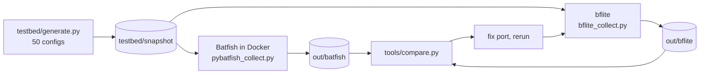
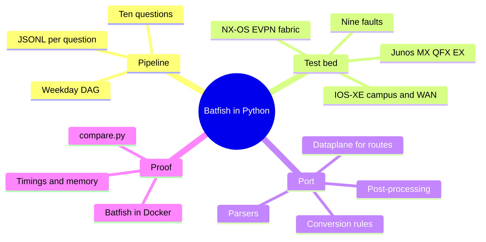

# Batfish config questions in pure Python

A pure-Python replacement for the Batfish questions our scheduled pipeline collects. It's needed because the Batfish Docker image can't run at work. The aim is the same structured data (BGP, layer 3, layer 2 and routes) in the same files, with nothing else changed downstream. The requirements come from the pipeline README (not included here). The port (`bflite/`) started from a semantic reading of the Batfish source (`docs/BATFISH_SOURCE_MAP.md`).

<!-- toc -->
**Contents**

- [Why it matters](#why-it-matters)
- [What the pipeline collects](#what-the-pipeline-collects)
- [Shape](#shape)
- [Status](#status)
- [What the first comparison found](#what-the-first-comparison-found)
- [Time and memory](#time-and-memory)
  - [Writing the files: stdlib, pandas or polars](#writing-the-files-stdlib-pandas-or-polars)
- [Stress test: 1,000 configs](#stress-test-1000-configs)
- [Open questions](#open-questions)
- [Links](#links)
- [Map](#map)
<!-- /toc -->

## Why it matters

- The pipeline feeds BGP-session, interface, VLAN and route data to everything downstream. Today it depends on a Batfish server.
- Running the Batfish image isn't allowed at work. A Python package that runs in the existing pipeline images removes that dependency.
- Batfish is heavy: a JVM service, gigabytes of RAM, and minutes per snapshot. The port should finish in seconds with modest memory.

[Back to top](#batfish-config-questions-in-pure-python)

## What the pipeline collects

From the photo of the pipeline README. Internal names are generalised here.

| pybatfish question | Script | Saved file |
|---|---|---|
| `initIssues()` | snapshot script | `init_issue/init_issue_<utc>.json` |
| `parseWarning()` | snapshot script | `parse_status/parse_warning_<utc>.json` |
| `interfaceProperties()` | interface property script | `interface_property/interface_property_<utc>.json` |
| `nodeProperties()` | node property script | `node_property/node_property<utc>.json` |
| `ipOwners()` | node property script | `ip_owner/ip_owner_<utc>.json` |
| `switchedVlanProperties()` | node property script | `vlan_property/vlan_property<utc>.json` |
| `bgpPeerConfiguration()` | BGP peer config script | `bgp_peer_configurations/bgp_peer_configuration_<utc>.json` |
| `bgpSessionCompatibility()` | BGP peer config script | `bgp_session_compatibility/bgp_session_compatibility_<utc>.json` |
| `bgpSessionStatus()` | BGP peer config script | `bgp_session_status/bgp_session_status_<utc>.json` |
| `routes()` | routes script | `routes/routes_<utc>.json` |

How the pipeline runs and writes its output:
- **Inputs:** device configs are copied from the config repo into the snapshot folder. A pybatfish `Session` then talks to the Batfish server (one network, snapshot `live`).
- **Output format:** every answer is cast to string and written as JSON lines (`to_json(orient="records", lines=True)`). `<utc>` is `datetime.now(UTC)` formatted `%Y%m%d_%H%M`. Questions are called with no node or property filters.
- **Quirks:**
  - `node_property` and `vlan_property` have no underscore before the timestamp.
  - `ipOwners` is the only answer written with a fixed column order (`IP, Node, VRF, Interface, Mask, Active`), and it's sorted by IP.
  - `fileParseStatus` is commented out, so only `parseWarning` is collected.
- **Schedule:** an Airflow DAG runs weekdays at 09:10 (Australia/Sydney), with one run at a time. Each task is a `DockerOperator`: the pybatfish steps use a pybatfish image, and snapshot copy and clean-up use a git image.

`collector/spec.py` encodes all of this, so both collectors write identical file names and formats.

[Back to top](#batfish-config-questions-in-pure-python)

## Shape

- **Test bed:** 50 devices. Site A is an NX-OS VXLAN EVPN fabric (12). Site B is an IOS-XE campus with a WAN edge (14). Site C is a Junos MX, QFX and EX campus (24). Cross-vendor eBGP joins the sites. Nine deliberate faults cover every status column: half-open, unknown remote, local IP unknown, dynamic match, autostate failure, disabled LAG members, multihop, and no remote AS.
- **Reference:** real Batfish (`batfish/allinone`) on the laptop's Docker, collected exactly like production.
- **Port:** `bflite/` parses IOS/IOS-XE, NX-OS and Junos into a vendor-independent model. It applies Batfish's conversion and post-processing rules, and answers with the same columns. The collector writes JSONL without pandas.

[Back to top](#batfish-config-questions-in-pure-python)

## Status

Compared on 2026-11-19 against `batfish/allinone` (pybatfish 2026.08.27, pandas 3.0.5) on the 50-device test bed. "Identical rows" counts rows where every column matches, after lining rows up on their key columns.

| Question | Port | Identical rows (Batfish vs port) |
|---|---|---|
| interfaceProperties | Done | 100% (853 rows) |
| ipOwners | Done | 100% (257) |
| switchedVlanProperties | Done | 100% (160) |
| bgpPeerConfiguration | Done | 100% (129) |
| bgpSessionCompatibility | Done | 100% (129) |
| bgpSessionStatus | Approximate (no RIB yet), but matches on the test bed | 100% (129) |
| routes | To build: connected, local, static, BGP | Batfish: 1,642 rows |
| nodeProperties | To build | Batfish: 50 rows |
| initIssues, parseWarning | Own warnings only; can't match Batfish's ANTLR messages line for line | Batfish: 64 and 110 rows |

Earlier verification of the port against Batfish's own example network matched all 1,388 interface and BGP fields it checks, and the `bgpSessionStatus` reference answer row for row (see `docs/BFLITE_README.md`). `tests/test_batfish_rules.py` pins each rule below, and every one was also checked with a small probe config in the running Batfish container.

[Back to top](#batfish-config-questions-in-pure-python)

## What the first comparison found

The first run matched ipOwners and the three BGP questions straight away. interfaceProperties had 41% identical rows and switchedVlanProperties none. Every difference traced to one Batfish rule:

| Difference | Batfish rule (source) |
|---|---|
| `Interface_Type` column only in the port | Not in the default column set (`InterfacePropertySpecifier.create`) |
| `Blacklisted` empty on 389 interfaces | `False` only for physical interfaces, empty for all other types (`Interface.setInterfaceType`) |
| List cells such as `[acc-b01[Vlan1]]` | pybatfish's `ListWrapper` prints through pandas `pprint_thing`: strings quoted, interfaces as `host[iface]`, at most 100 items then `...` |
| Interface order inside lists | `InterfaceNameComparator`: numbers numerically, text ignoring case |
| IOS `Native_VLAN` on access ports | Set on trunks only |
| IOS portfast `True` in the port, `False` in Batfish | Copied for switchports only. The global `spanning-tree portfast default` is read when each interface is created, and on the test bed it never took effect (next row) |
| IOS line absorption | Batfish's IOS grammar ignores indentation. `spanning-tree` lines straight after a `vlan` stanza belong to that stanza, and `vlan <id>` lines straight after an interface become interface commands that set `Encapsulation_VLAN` (core-b1 and core-b2 `Te1/1/8` = 210) |
| NX-OS `nve~50001` rows | One TUNNEL interface per layer-3 VNI in the tenant VRF, address `link-local:169.254.0.1` (`VxlanTopologyUtils.addTenantVniInterfaces`). Needs an NVE that isn't shut down |
| Junos unit description and MTU | Units inherit them from the physical interface (`Interface.inheritUnsetFields`), including MTU set by a wildcard group |
| Junos `irb` row only in the port | `irb` is a namespace, not an interface (`resolveInterfacePointers`) |
| Junos trunks with no VLANs in Batfish | `set ... vlan members [ A B C ]` isn't valid flat syntax, so Batfish drops the line with a parse warning. Real `display set` output never has brackets |
| Junos `VXLAN_VNI` empty in Batfish | Needs `switch-options vtep-source-interface` with an address (`convertVxlan`) |

The IOS absorption and Junos bracket cases come from the test-bed generator writing stanzas in an order, or with syntax, that real devices don't produce. The port copies Batfish anyway, because the aim is identical output.

[Back to top](#batfish-config-questions-in-pure-python)

## Time and memory

Same laptop (Intel Mac, 16 GB), same 50 configs, the six questions the port answers:

| | Batfish (Docker) | bflite |
|---|---|---|
| Load snapshot | 19.7 s | 0.08 s |
| Six questions | 11.1 s (bgpSessionStatus 5.3 s) | 0.13 s |
| Whole run | 30.8 s, plus starting the JVM container (not timed) | 0.3 s for the whole process |
| Memory | 1.74 GiB held by the container | 20 MB peak for the whole process |

Batfish's full ten-question run took 35.5 s (`out/batfish/timings.json`).

### Writing the files: stdlib, pandas or polars

The last step turns each answer into text and writes JSON lines. `tools/bench_writers.py` times three ways of doing it on the same rows, each in a fresh process, with the rows repeated to 10 and 100 times the test bed:

| Rows | stdlib (bflite) | pandas (production) | polars |
|---|---|---|---|
| 1,657 | 0.05 s | 0.10 s | 0.07 s |
| 16,570 | 0.43 s | 0.50 s | 0.42 s |
| 165,700 | 4.1 s, +0 MB | 5.2 s, +519 MB | 3.8 s, +420 MB |
| Import time | none | 0.4–1.0 s | 0.2–0.6 s |

- **All three write the same records.** Missing values are the only difference in bytes: pandas 3 writes `null`, while stdlib and polars write `"None"` (as pandas 1 and 2 do).
- **polars has no real lead once the text has to match.** Cells hold Python objects (interface names, lists), so each cell must be converted to text in Python before polars sees it, and that conversion is most of the time. An early polars run that skipped the pandas-style list text looked twice as fast, but wrote different lists.
- **stdlib streams.** It holds one line at a time, so memory stays flat however many rows there are. pandas and polars build the whole table first.
- **Recommendation:** keep the stdlib writer. It's within 10% of polars at 165,000 rows, needs no package, and uses about 1/20 of the memory.

[Back to top](#batfish-config-questions-in-pure-python)

## Stress test: 1,000 configs

`testbed/generate_stress.py` writes 1,000 files (seed 7): 515 IOS / IOS-XE, 268 Junos and 213 NX-OS configs across 20 models and OS releases from 2010 (IOS 12.2, NX-OS 6.2, Junos 12.3) to 2024 (IOS-XE 17.12, NX-OS 10.3, Junos 23.2), in campus, data-centre, branch, PE and internet-edge roles, 245,000 lines in all. About 4% of BGP sessions carry a deliberate fault, and edge cases are scattered at random: CRLF, RANCID headers, banners holding config-like lines, odd and non-UTF-8 descriptions, wrapped VLAN lists, undefined policies, IPv6 peers, Junos interface-range and inactive statements, odd stanza order, junk files. `testbed/stress/manifest.json` records what each file carries. `tools/stress_port.py` checks the port for crashes and speed, and `tools/stress_report.py` groups every difference from Batfish by OS version and edge case.

First run on 2026-11-19, with the port as it stood after the first comparison, then again after fixing every case below:

| | Batfish | bflite |
|---|---|---|
| Whole run | 232 s (snapshot load 77 s, interfaceProperties 37 s, bgpSessionStatus 33 s) | 10 s (snapshot load 2.5 s) |
| Memory | 5.8 GiB | 211 MB |
| Crashes | none | none; vendor detected correctly for every real config |

| Question | First run | After the fixes |
|---|---|---|
| interfaceProperties | 95.2% | 100% (48,240 rows) |
| ipOwners | 98.9% | 100% (4,803) |
| switchedVlanProperties | 99.7% | 100% (33,941) |
| bgpPeerConfiguration | 99.1% | 100% (1,930) |
| bgpSessionCompatibility | 99.7% | 100% (1,930) |
| bgpSessionStatus | 87.4% | 90.6%; the rest need routes |

Every difference traced to one of these. Each was confirmed in the Batfish source or with a probe config, and each fixed case has a test in `tests/test_batfish_rules.py`. Those tests' configs were then run through Batfish too (`out/probe/rules2/`), and the port matched on all six questions:

| Edge case | Scale on the stress bed | Batfish behaviour | Port |
|---|---|---|---|
| Junos `interface-range` | 312 interfaces on 59 devices missing | Members (`member-range`, `member "ge-0/0/[1-4]"`) are created and take the range's description, MTU and 802.3ad when unset. Every `interface-range ... unit` line is rejected as unrecognised, so members get no units | Fixed |
| Junos eBGP without `local-address` | 59 sessions | For bgpSessionStatus the source IP is inferred from the FIB, so the session comes up; the port says NOT_COMPATIBLE | Fixed |
| NX-OS `boot ... sup-1` lines | 289 ports on N7Ks wrongly shut | The image is the path token; the port took the last token, so it missed the N7K platform | Fixed |
| NX-OS VLAN 1 | 1,139 cells | VLAN 1 isn't defined unless the config says so; an access VLAN 1 is then empty | Fixed |
| NX-OS `switchport access vlan` without `switchport` | 43 ports | Sets the mode to ACCESS when no mode is set | Fixed |
| IOS `HundredGigE` | 54 interfaces renamed, which also changes ipOwners keys | Batfish's name table maps it to `HundredGigabitEthernet`; copy the whole table | Fixed |
| VRRP | 452 cells | IOS-XE `vrrp N address-family ipv4` gives no group; Junos `vrrp-group` does | Fixed |
| SRX security zones | 29 cells | `Zone_Name` comes from the zone | Fixed |
| `no bgp default ipv4-unicast` | 2 peers and their sessions | Ignored: unactivated neighbours stay, as IPv4 | Fixed |
| `alternate-as` on a dynamic peer group | 1 peer | Remote_AS becomes a range such as `65000-65002` | Fixed |
| Junos old `vlan.N` (non-ELS) | 53 EX4200s | Gets no VLAN from `l3-interface`, so it isn't a VLAN member | Fixed |
| Secondary addresses | 1 cell | `All_Prefixes` is sorted | Fixed |
| Duplicate group-level Junos `export` | 14 peers | Policy names aren't repeated | Fixed |
| Non-UTF-8 descriptions; `\"` inside Junos descriptions | 44 cells | Latin-1 bytes decode as characters; Batfish splits escaped quotes oddly | Fixed |
| Duplicate hostnames | 2 files | Both nodes are renamed `host__configs__file.cfg` | Fixed |
| Overlay sessions behind a broken underlay | 182 sessions | Needs routes (work item 3); the port's adjacency check can't see it | Open: needs routes |
| Found while fixing: NX-OS description length | 8 cells | Interface descriptions over 254 characters and BGP neighbour descriptions over 80 are rejected, so they're empty | Fixed |
| Found while fixing: Junos `irb` unit with no VLAN | (none on the stress bed) | Deactivated, `Incomplete configuration`, unless a VLAN's `l3-interface` points at it | Fixed |
| Found while fixing: `no neighbor X activate` (IOS) | (none on the stress bed) | Drops the peer | Fixed |

[Back to top](#batfish-config-questions-in-pure-python)

## Open questions

- **Can a Python package run in the existing pipeline images at work?** If not, `bflite` needs no third-party packages beyond the standard library; pandas is only used for `.frame()`.
- **Do downstream consumers depend on row order?** Batfish doesn't guarantee one. `compare.py` ignores it.
- **What do consumers use from `initIssues` and `parseWarning`?** If those are only health signals, our own parse warnings may be enough.
- **Which routing protocols run in the real network** (OSPF, IS-IS, static only)? This decides how much of a dataplane `routes` needs.
- **Does the work pipeline run on pandas 2 or pandas 3?** It changes whether missing values are written as `"None"` or `null`. The current `batfish/allinone` image ships pandas 3.0.5 and writes `null`; bflite writes `"None"`. `compare.py` treats them as equal, but a downstream parser might not.

[Back to top](#batfish-config-questions-in-pure-python)

## Links

- [[intent-cicd-scenarios]] · [CI/CD scenarios for the network intent catalogue](../intent-cicd-scenarios/intent-cicd-scenarios.md): Batfish in other teams' pipelines
- [[network-intent-catalogue]] · [Network intent catalogue](../network-intent-catalogue/network-intent-catalogue.md): consumer of the structured data
- [[ndfc-vxlan-automation]] · [NDFC VXLAN automation](../ndfc-vxlan-automation/ndfc-vxlan-automation.md): the NX-OS fabric the test bed imitates
- Work plan and commands: [HANDOFF.md](HANDOFF.md)
- Source analysis: [docs/BATFISH_SOURCE_MAP.md](docs/BATFISH_SOURCE_MAP.md)
- Batfish (Apache-2.0): [github.com/batfish/batfish](https://github.com/batfish/batfish) · [pybatfish](https://github.com/batfish/pybatfish)

[Back to top](#batfish-config-questions-in-pure-python)

## Map

[Back to top](#batfish-config-questions-in-pure-python)
